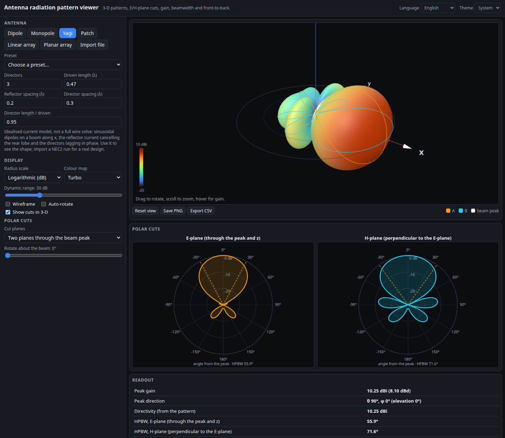

# Antenna Radiation Pattern Viewer

A 3D viewer for antenna radiation patterns that runs entirely in your browser. Pick a built-in analytic antenna (dipole of any length, monopole over ground, Yagi, microstrip patch, uniform or tapered linear and planar arrays with beam steering), or import your own pattern from a CSV, a NEC2 output file or an MSI Planet antenna file. You get a colored 3D surface, E/H-plane polar cuts, and readouts for peak gain, half-power beamwidth, sidelobe level and front-to-back ratio.

**Try it: [hermes98761234.github.io/radiation-pattern-viewer](https://hermes98761234.github.io/radiation-pattern-viewer/)**

[](https://github.com/hermes98761234/radiation-pattern-viewer/actions/workflows/deploy.yml)



## Features

- **Analytic antennas.** Thin dipole of any length (sinusoidal current), monopole over a perfect ground plane, Yagi-Uda (idealised current model, up to 20 directors), rectangular patch (two-slot cavity model, with a size calculator from frequency, εr and substrate height), uniform linear arrays and rectangular planar arrays.
- **Phased arrays.** Steer the beam in θ/φ (or from broadside, to end-fire), pick an amplitude taper (uniform, Hamming, Hann, Blackman, triangular, Dolph-Chebyshev with a chosen sidelobe level) and an element pattern (isotropic, half-wave dipole, cosine/patch-like). Spacing above half a wavelength shows grating lobes.
- **Import real data.**
  - **CSV**: `theta, phi, gain` in any delimiter, with or without a header, polar angle or elevation, dB or linear power. A single `angle, gain` cut is revolved around z.
  - **NEC2 output**: reads the `RADIATION PATTERNS` table (TOTAL gain column, `-999.99` treated as no radiation).
  - **MSI Planet** `.msi` / `.pln`: rebuilds the 3D pattern from the horizontal and vertical attenuation cuts and the stated gain (dBd or dBi).
  - Drop a file, open one, or paste its contents. Built-in example files show each format.
- **3D surface** (Three.js) with logarithmic, linear-power or linear-field radius, adjustable dynamic range, four colour maps, wireframe, auto-rotate, hover to read the gain in any direction, PNG snapshot.
- **Polar cuts.** Two orthogonal great-circle cuts through the beam peak (E- and H-plane for the single antennas, rotatable about the beam), or a chosen elevation cut and azimuth cut. Both are drawn on the 3D surface too.
- **Readouts.** Peak gain (dBi and dBd) and direction, directivity from the pattern integral, implied radiation efficiency for imported data, HPBW of each cut, highest sidelobe, front-to-back (180° from the peak) and front-to-rear (worst rear direction).
- **CSV export** of the current pattern.
- **English or Ukrainian, light, dark or system theme.** Settings are kept in the browser. No backend, no tracking; your files never leave the page.

## How it works

Every pattern is a grid of gain in dBi on 1° steps of θ (from +z) and φ (from +x towards +y). Analytic models give a relative power pattern, which is normalised by its numerical solid-angle integral so that gain = 4π·U / ∫U dΩ (lossless). Imported data is placed on the same grid (bilinear interpolation of a regular θ/φ lattice, or binning and nearest-neighbour fill for scattered points), and areas the file does not cover are drawn as no radiation, with the covered fraction reported.

Formulas used:

- Dipole: `E(θ) = [cos(πL cosθ) − cos(πL)] / sinθ`. A half-wave dipole gives 2.15 dBi and a 78° beamwidth. A monopole of height h is the upper half of a dipole of length 2h.
- Patch: two in-phase slots of width W spaced L apart over an infinite ground plane, `U = (cos²φ + cos²θ sin²φ) · sinc²(kW/2 · sinθ sinφ) · cos²(kL/2 · sinθ cosφ)`; the design helper uses the transmission-line model from Balanis.
- Arrays: `AF = |Σ wₙ e^{jk rₙ·(û − û₀)}|`, separable for planar lattices. Dolph-Chebyshev weights follow the same construction as `scipy.signal.windows.chebwin`.
- Yagi: sinusoidal dipoles on a boom; the reflector current is chosen to cancel the rear lobe (15 % under-driven) and the directors carry a decaying amplitude with a slow-wave phase lag. This shows the shape of a Yagi but is not a method-of-moments solve; import a NEC2 run for real design numbers.

The unit tests check the code against textbook values: half-wave dipole 2.15 dBi and 78.1° HPBW, short dipole 1.76 dBi, full-wave dipole 3.8 dBi, quarter-wave monopole 5.16 dBi, N isotropic elements at half-wave spacing D = N, uniform-array first sidelobe of −13.3 dB, the Chebyshev design sidelobe level, an independent sinc-sum directivity of a 4 × 4 planar array, and the Balanis patch-design example.

## Limitations

- Patterns are scalar gain (total power). Polarisation and phase are not shown.
- An MSI pattern is an approximation built from two cuts, as the format only stores two.
- The analytic models assume lossless antennas, a perfect infinite ground plane where one is used, and no mutual coupling.
- Large arrays are limited to 32 × 32 elements (64 for linear). The 1° grid resolves beams down to a few degrees.
- Needs WebGL for the 3D view; the polar cuts and readouts work without it.

## Quick start

You need [Node.js](https://nodejs.org/) 22.

```bash
git clone https://github.com/hermes98761234/radiation-pattern-viewer.git
cd radiation-pattern-viewer
npm install
npm run dev       # http://localhost:5173
npm test          # pattern maths, analysis, importers and i18n tests
npm run build     # static site in dist/
```

## License

MIT
